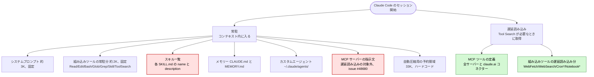
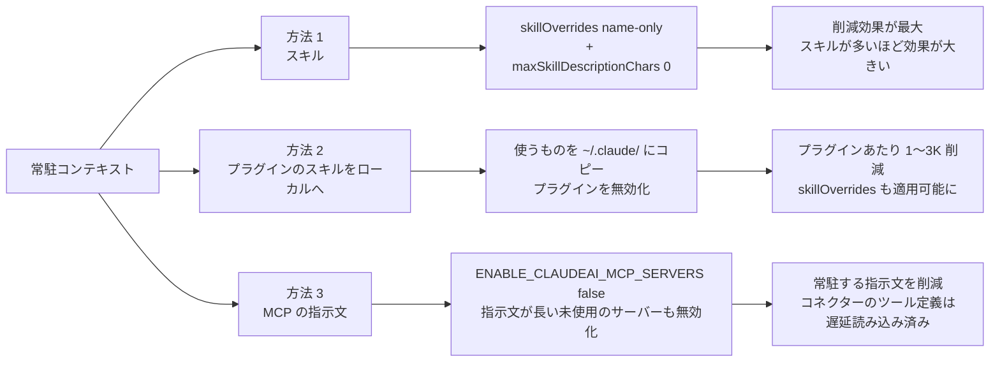
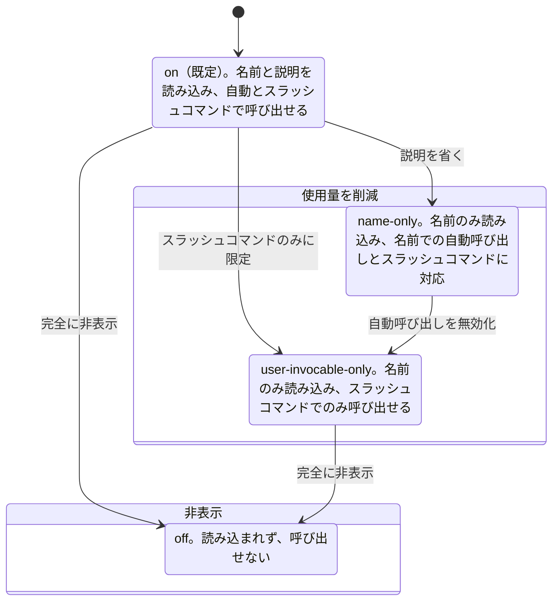
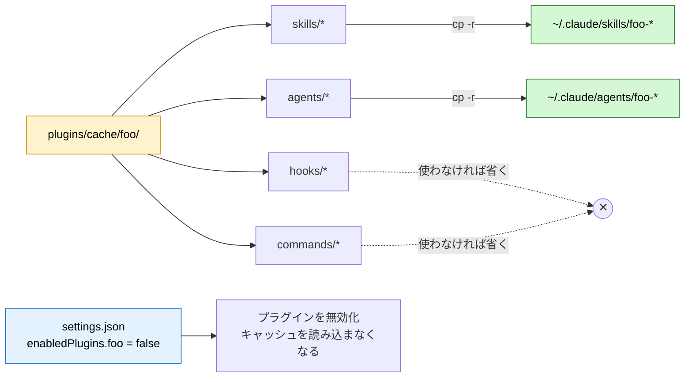
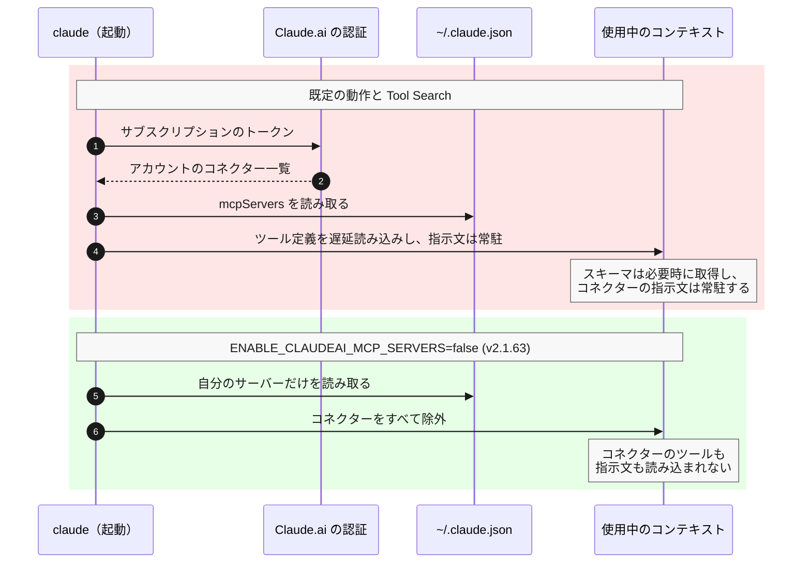
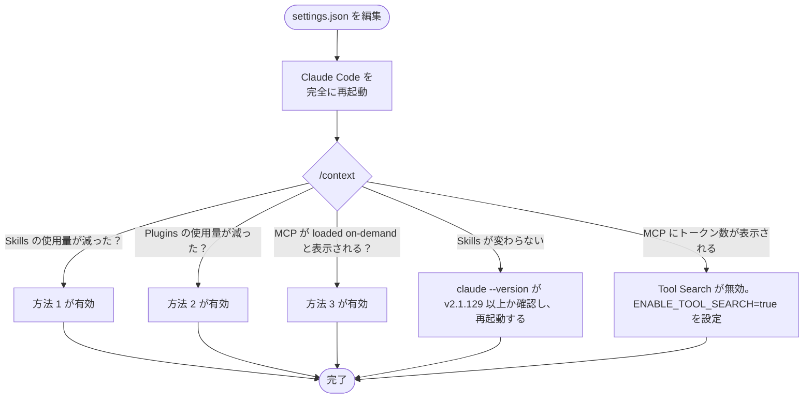

import { ArticleLayout } from '@/components/ArticleLayout'

export const article = {
  author: 'Ryota Murakami',
  title:
    'Claude Code の初期コンテキストを減らす。スキル、プラグイン、MCP の設定',
  date: '2026-05-21',
  description:
    'Tool Search が MCP と組み込みツールの定義を遅延読み込みするとき、起動時に実際に何が入るのかを調べます。表示された項目の合計より実際の使用量が少ない理由と、削減効果が大きいスキル一覧、プラグイン、MCP サーバーの指示文の調整方法を解説します。',
}

export default (props) => <ArticleLayout article={article} {...props} />

## `/context` で見る問題の全体像

Claude Code で新しいセッションを開き、「hi」と入力してから `/context` を実行します。MCP サーバーが 22 以上、スキルが 150 以上、プラグインが 6 個ほどある私の設定では、実際のコンテキスト使用量はこんな具合です。

```
Context Usage — Opus 4.7
16.8k / 200k tokens (8%)

Estimated usage by category
- System prompt:        2.8k   (1.4%)
- System tools:         2k     (1.0%)
- Custom agents:        1.4k   (0.7%)
- Memory files:         2.2k   (1.1%)
- Skills:               8.3k   (4.2%)   ← biggest controllable line
- Messages:             13 tokens
- Free space:           150.2k (75.1%)
- Autocompact buffer:   33k    (16.5%)  ← reserved, hardcoded

MCP tools · /mcp (loaded on-demand)      ← NOT counted above
```

入力前に実際に常駐しているのは約 16.8K です。そのほとんどは調整のきかない項目です。システムプロンプト、遅延読み込みされない組み込みツールには固定のコストがあり、自動圧縮用に確保された 33K も取り戻せません。22 以上ある MCP サーバーと遅延読み込み対象の組み込みツールは、実際の使用量に**まったく加算されません**。Tool Search は名前を一覧に載せ、スキーマを必要になったときだけ取得します。そのため、これらはコンテキストの外にある「loaded on-demand」の別枠に表示されます。

設定で減らせる項目のうち、最も大きいのは **Skills** です。

> **訂正（2026 年 5 月）。** 以前の記事では `MCP tools (deferred): 67.6k ← biggest culprit` を最大の原因に挙げ、「会話を始める前に約 66K が消えている」と書きました。`/context` の読み違いです。遅延読み込みの数字は、後から取得できるものの量です。実際、旧版の出力では総量が 33.8K なのに、遅延読み込みは 67.6K と表示されていました。内訳が総量より大きかったのは、そもそも使用量の内訳に入っていなかったからです。現在の一般的な設定では Tool Search が既定で有効なので、MCP や組み込みツールの**定義**は遅延読み込みされ、起動時のコンテキストには入りません。実際に削減できる量はずっと少なく、その大部分は Skills です。以降はこの理解に基づいて説明します。また、`/context` に MCP サーバーの指示文の項目がない点は、後の節で取り上げます。

---

## 起動時に入るものと、後から読み込むもの

起動時に扱うのは、固定のシステムプロンプトと、**動的に見つけたリソース**です。前の記事で見落としていたのは、Tool Search がそれらを 2 種類に分けることです。MCP の公式ドキュメントには「Tool Search は既定で有効です。MCP ツールを最初からコンテキストに入れず、遅延読み込みします」とあります。

- **常駐**。セッションを開いた時点でコンテキストウィンドウを消費します。
- **遅延読み込み**。起動時は検出して名前を一覧に載せ、完全な定義は必要になったときに取得します。起動時のコンテキスト使用量には**含まれません**。



赤で示した **スキルの一覧**と **MCP サーバーの指示文**が、削減できる常駐コストです。緑の MCP ツール定義（規模の大きい claude.ai コネクターのカタログも含む）や遅延読み込み対象の組み込みツールは、Tool Search のおかげで起動時の使用量に入りません。残りは固定（システムプロンプト、組み込みツール、自動圧縮用バッファー）か、量が少ない項目（メモリー、エージェント）です。

### 各項目の読み込みを説明している公式資料

| 項目                 | 読み込み時の動作                                                                                                                                                                                                                           | 出典                                                                                                                                                                                                                                                 |
| -------------------- | ------------------------------------------------------------------------------------------------------------------------------------------------------------------------------------------------------------------------------------------ | ---------------------------------------------------------------------------------------------------------------------------------------------------------------------------------------------------------------------------------------------------- |
| Tool Search          | MCP と組み込みツールの**定義**を遅延読み込みし、必要になったときだけ取得する。起動時のウィンドウに入らないため、常駐分が小さくなる                                                                                                         | [Claude Code の MCP ドキュメント](https://code.claude.com/docs/en/mcp)、[Tool Search SDK](https://code.claude.com/docs/en/agent-sdk/tool-search)、[API リファレンス](https://platform.claude.com/docs/en/agents-and-tools/tool-use/tool-search-tool) |
| MCP ツール定義       | 他のツールと同様に Tool Search で遅延読み込みされる。名前を一覧に載せ、スキーマは必要になったときに取得する                                                                                                                                | [Claude Code の MCP ドキュメント](https://code.claude.com/docs/en/mcp)                                                                                                                                                                               |
| MCP サーバーの指示文 | 接続したサーバーごとに最大 2KB の指示文が加わる。常駐するので、次の節で仕組みと測定方法を説明する                                                                                                                                          | [Claude Code の MCP ドキュメント](https://code.claude.com/docs/en/mcp)、[Issue #48680](https://github.com/anthropics/claude-code/issues/48680)                                                                                                       |
| claude.ai コネクター | Pro / Max アカウントでサインインすると Gmail、Linear、Notion などのコネクターが利用可能になる。ツール定義は他と同様に遅延読み込みされ、2KB 以下の指示文だけが常駐する。CLI で無効にするには `ENABLE_CLAUDEAI_MCP_SERVERS=false` を指定する | [Claude Code の MCP ドキュメント](https://code.claude.com/docs/en/mcp)、[Issue #50062](https://github.com/anthropics/claude-code/issues/50062)                                                                                                       |
| スキル               | 各 `SKILL.md` のフロントマター（`name` と `description`）を 1 つの一覧にまとめ、システムプロンプトに**常駐**させる。設定で削減できる項目のうち最も大きい                                                                                   | [Claude Code のスキル](https://code.claude.com/docs/en/skills)、[agentskills.io の仕様](https://agentskills.io/client-implementation/adding-skills-support)                                                                                          |
| スキルの検索パス     | `~/.<client>/skills/`、`~/.agents/skills/` と、それぞれに対応するプロジェクト内のパスの計 4 か所を検索する                                                                                                                                 | [Agent Skills のクライアント実装ガイド](https://agentskills.io/client-implementation/adding-skills-support#where-to-scan)                                                                                                                            |
| プラグイン           | マーケットプレイスのプラグインは、フック、エージェント、スキル、コマンドを `plugins/cache/` に配置する。**プラグインのスキルは `skillOverrides` では制御できない**                                                                         | [プラグインのドキュメント](https://code.claude.com/docs/en/plugins)、[スキルの上書きに関する注意](https://code.claude.com/docs/en/skills)                                                                                                            |
| 自動圧縮用バッファー | ウィンドウの先頭に 33K を確保する。環境変数で変えられるのは自動圧縮を実行するしきい値だけで、確保する量は変わらない                                                                                                                        | [Issue #12053](https://github.com/anthropics/claude-code/issues/12053)、[Issue #31806](https://github.com/anthropics/claude-code/issues/31806)                                                                                                       |

初期の調査では、Scott Spence の[Claude Code で MCP サーバーのコンテキスト使用量を抑える方法](https://scottspence.com/posts/optimising-mcp-server-context-usage-in-claude-code)と、atcyrus の[MCP Tool Search とコンテキスト消費のガイド](https://www.atcyrus.com/stories/mcp-tool-search-claude-code-context-pollution-guide)が大いに参考になりました。記事の時期には注意が必要です。大幅に使用量が減ったという数字は、まだ Tool Search が定義を遅延読み込みしなかった頃のものです。そこで説明されている仕組みは今も関係しますが、現在削れるのは、60K ものツールスキーマが占めていた分ではなく、残った*指示文*の分です。しかも、そのコストは `/context` の内訳に出ないので、思ったより把握しにくいのです。

---

## MCP サーバーの指示文が `/context` に出ない理由

MCP サーバーを 20 以上つないだセッションで `/context` を実行しても、指示文のコストを示す行は見つかりません。`/context` が使用量の表示を組み立てるときに使う分類は、`System prompt`、`System tools`、`MCP tools`、`MCP tools (deferred)`、`Custom agents`、`Memory files`、`Skills`、`Messages` の 8 つです。それぞれを名前付きの行として表示しますが、「MCP instructions」という行は以前からありません。

では、指示文はどこに入るのでしょうか。セッション開始時、Claude Code は接続したサーバーの指示文を `# MCP Server Instructions` という 1 つのブロックにまとめ、内部の `mcp_instructions_delta` チャンネルから送ります。会話ログでは `<system-reminder>` としてインラインに表示されます（これらの名前は v2.1.153 のバンドルで確認済みです）。ブロックは静的なシステムプロンプトとは別に、メッセージの添付データとして渡され、`isMeta: true` が付きます。そのため、どちらの集計にも入りません。

- 「System prompt」の集計対象は、システムプロンプトの静的な部分だけです。メッセージに添付されたものは対象外です。
- 「Messages」の集計は、`isMeta` のブロックを明示的に除外します。

これが測定の抜けです。最初の実際のやり取りの前に表示される `/context` の合計は、画面に見える項目の合算です。どちらの項目にも MCP の指示文が含まれないので、合計はその分だけ実際より小さく出ます。最初のやり取りの後は、API が返す実際のトークン使用量（入力とキャッシュ読み取りの合計）に切り替わり、指示文も暗黙に計上されます。それでも個別の内訳は出ません。

指示文だけのコストを知るには、自分で測定します。

| 知りたいこと                 | 確認方法                                                                                                                                                                                                           |
| ---------------------------- | ------------------------------------------------------------------------------------------------------------------------------------------------------------------------------------------------------------------ |
| 指示文の原文                 | `~/.claude/projects/<encoded-cwd>/<session-id>.jsonl` にあるセッションログを開き、本文が `# MCP Server Instructions` で始まる添付データを探す                                                                      |
| 実際に常駐するコスト（差分） | サーバーに接続して 1 回やり取りしたあとに `/context` を実行する。サーバーを無効にして（コネクターなら `ENABLE_CLAUDEAI_MCP_SERVERS=false`、または `.mcp.json` から削除）、もう一度計測する。合計の差がコストになる |
| 指示文 1 件のコスト          | JSONL のテキストを `system` ブロックとして `/v1/messages/count_tokens` に送る。Claude Code が `/context` の内訳の計算に使うのもこのエンドポイント                                                                  |
| 上限                         | サーバーごとの指示文は UTF-16 で 2048 文字まで。常駐分の合計は N × 2KB 以下                                                                                                                                        |

8 項目の分類と `isMeta` の除外は、いずれも v2.1.153 のバンドルで確認できます。`strings ~/.local/share/claude/versions/2.1.153 | grep -E 'mcp_instructions_delta|getMcpInstructionsDeltaAttachment'` を実行すると、チャンネル名と、指示文を挿入するゲッターが見つかります。

---

## 使用量を減らす 3 つの方法



3 つの方法はいずれも、最初のプロンプトを処理する前に Claude Code が見つけ、コンテキストに**常駐**させるものを対象にします。削減効果が大きい順です。最初に取り上げるスキルが、現在もっとも削減しやすい項目です。MCP は Tool Search が大部分を遅延読み込みにしてくれるので最後です。

---

## 方法 1：`skillOverrides` でスキルの一覧を短くする

### Skills の使用量に含まれるもの

起動時に見つかった各 `SKILL.md` から、`name`（数トークン）と `description`（`maxSkillDescriptionChars` で指定する文字数まで。既定値は **1536**）をシステムプロンプトのスキル一覧に載せます。この一覧は遅延読み込みの対象外で、**常駐**します。説明を上限まで書いたスキルが 150 個あれば、ここだけで 15K トークンを大きく超えかねません。冒頭の `/context` の 8.3K は、すでに削減した*あとの*値です。まず見直すならこの項目です。

### 4 つの設定値（2026 年 5 月訂正）

`skillOverrides` は、ディレクトリ名をキーにした**スキルごとの設定オブジェクト**です。以前に公開した自分の調査メモでは文字列での指定（`"skillOverrides": "user-invocable-only"`）を勧めましたが、この形式では **JSON スキーマの検証に失敗します**。使えるのはオブジェクト形式だけです。

次の状態遷移図は、4 つの設定値と、使用量を段階的に抑える切り替え方を示しています。既定の `on` に対し、使用量を減らせるのは自動呼び出しを維持する `name-only` と、明示的にスラッシュコマンドで呼ぶ必要がある `user-invocable-only` です。完全に非表示にするには `off` を使います。



使用量を抑える 2 つの設定値で大きく違うのは、**自動呼び出し**です。`user-invocable-only` は文字どおり、`/skill-name` でのみスキルを使えます。自動呼び出しが無効になるので、タスクに合うスキルがあってもモデルは自分から呼びません。`name-only` は一覧に名前を残し、自動呼び出しを維持します。モデルは必要に応じてそのスキルを読み込み、実行できます。

この違いがあるので、私はすべて `name-only` にしました。私の作業では `/goal "do X"` のような自然な言葉で指示を出すことが多く、モデル（またはモデルが起動したサブエージェント）が「この作業には _qa-team_ が合う」と判断して、スラッシュコマンドなしで読み込める必要があります。`user-invocable-only` にすると自動では読み込まれず、私がスキル名を毎回覚えて入力しないといけません。手動だけに限定したいスキルが出てきたときのために、この設定値は選択肢として残していますが、今のところそうしたスキルはありません。

### 設定手順

```bash
# Apply name-only to every locally-discoverable skill
SKILLS=$(find ~/.claude/skills ~/.agents/skills -maxdepth 2 -name "SKILL.md" 2>/dev/null \
  | sed 's|.*/skills/||; s|/SKILL.md$||' | sort -u)

OVERRIDES=$(echo "$SKILLS" | jq -R . | jq -s 'map({(.): "name-only"}) | add')

jq --argjson o "$OVERRIDES" '
  .skillOverrides = $o |
  .maxSkillDescriptionChars = 0 |
  .skillListingBudgetFraction = 0.005
' ~/.claude/settings.json > /tmp/s.json && mv /tmp/s.json ~/.claude/settings.json
```

3 つの設定は、役割がそれぞれ異なります。

| 設定                         | 既定値 | 私の設定値                       | 理由                                                                         |
| ---------------------------- | ------ | -------------------------------- | ---------------------------------------------------------------------------- |
| `skillOverrides`             | `{}`   | `{ <every-skill>: "name-only" }` | 説明を省き、自動呼び出しとサブエージェントからの呼び出しを維持する           |
| `maxSkillDescriptionChars`   | `1536` | `0`                              | 説明をすべて省略し、名前だけを残す。個別の上書きを忘れたスキルにも適用される |
| `skillListingBudgetFraction` | `0.01` | `0.005`                          | スキル一覧がウィンドウを占める割合に上限を設ける                             |

編集したら Claude Code を完全に再起動します。スキル一覧はセッション中にキャッシュされるためです。`/context` を実行して `Skills` の行を確認します。

### 注意点

- **プラグインのスキルには `skillOverrides` が効きません。** そのため方法 2 が必要になります。
- **バージョンを確認してください。** `skillOverrides` は v2.1.129 まで正しく動かず、それより前のビルドでは常に `on` を返すスタブでした（[Issue #50631](https://github.com/anthropics/claude-code/issues/50631)）。`claude --version` で確認できます。組み込みスキルにも `skillOverrides` が効くかは未確認です。それらを無効にする機能の要望（[Issue #26838](https://github.com/anthropics/claude-code/issues/26838)）は重複としてクローズされています。
- フロントマターの `disable-model-invocation: true` と `user-invocable: false` でも同様に設定できますが、一括で適用するなら `skillOverrides` のほうが早いです。

---

## 方法 2：プラグインから使うものだけをローカルに移す

マーケットプレイスのプラグインは便利ですが、フック、エージェント、スキル、コマンドをひとまとめに有効化します。付属のスキルは `~/.claude/plugins/cache/.../skills/` に置かれ、公式ドキュメントのとおり、**`skillOverrides` では制御できません**。自動で呼び出すことのない、説明の長いスキルが 5 個含まれていたら、その説明すべてが毎回セッションに常駐します。

対処法は、**使うものだけをユーザー用のディレクトリにコピー**してから、プラグインを無効にすることです。



### 手順

1. **プラグインに何が含まれているか確認します。** プラグインのキャッシュには、配布元の `skills/`、`agents/`、`hooks/`、`commands/` と同じ構成でファイルが入っています。

   ```bash
   ls ~/.claude/plugins/cache/<plugin>@<marketplace>/
   ```

2. **使うものだけをユーザー用のディレクトリにコピーします。**

   ```bash
   cp -r ~/.claude/plugins/cache/codex@openai-codex/skills/codex-cli-runtime \
         ~/.claude/skills/

   cp -r ~/.claude/plugins/cache/coderabbit@claude-plugins-official/agents/code-reviewer \
         ~/.claude/agents/
   ```

3. **プラグインを無効にします。** `~/.claude/settings.json` の `enabledPlugins` から該当するキーを削除するか、`claude plugin uninstall <plugin>@<marketplace>` を実行します。

4. **ローカルに移したスキルを `skillOverrides` に追加します。** ユーザーのスキルになったので、方法 1 が使えます。用途に合わせて `name-only` または `user-invocable-only` を指定します。

5. **プラグインが更新されたら**、コピーし直します。自動更新の手間を手放す代わりに、`skillOverrides` で制御でき、毎回のコンテキスト使用量も減らせます。めったに使わないプラグインなら、私はこの手間を受け入れられます。

### 最近ローカルに移したもの

| プラグイン                                     | 残したもの                                                                                              | 無効化               | 削減したトークン数                       |
| ---------------------------------------------- | ------------------------------------------------------------------------------------------------------- | -------------------- | ---------------------------------------- |
| `codex@openai-codex`                           | `codex-rescue` エージェントと、`codex-cli-runtime`、`codex-result-handling`、`gpt-5-4-prompting` スキル | 済み                 | 約 1.4K（`skillOverrides` も適用可能に） |
| `coderabbit@claude-plugins-official`           | `code-reviewer` エージェントと、`autofix`、`code-review` スキル                                         | 済み                 | 約 1K                                    |
| `figma@claude-plugins-official`                | グローバルには何も残さず、`zumen-fe` の `.claude/settings.local.json` でだけ有効化                      | 済み（ユーザー設定） | 約 1.4K                                  |
| `claude-md-management@claude-plugins-official` | 使っていなかったため、何も残していない                                                                  | 済み                 | 少量                                     |

Figma の例は、もう一つの方法を示しています。**プラグインを 1 つのプロジェクトに限定**する方法です。ユーザー設定で無効にして、使うプロジェクトの `.claude/settings.local.json` でだけ有効にします。

```json
{ "enabledPlugins": { "figma@claude-plugins-official": true } }
```

このプラグインが読み込まれるのは、そのプロジェクトに `cd` したときだけです。

---

## 方法 3：Tool Search で遅延読み込みされない MCP の使用量を減らす

以前の記事では、この点を逆に捉えていました。現在の Claude Code では **MCP ツールの定義を Tool Search が遅延読み込み**するので、起動時のウィンドウには入りません。公式ドキュメントにも「Tool Search は既定で有効です。MCP ツールを最初からコンテキストに入れず、遅延読み込みします」とあります。「claude.ai コネクターを止めれば約 100K 削減できる」という以前の話は、遅延読み込み導入前の状況を述べたものです（[Issue #50062](https://github.com/anthropics/claude-code/issues/50062) は対応済みでクローズ）。今はコネクターのツール定義も他と同じように遅延読み込みされます。実際に常駐するコストは、次の 2 つです。

1. **MCP サーバーの指示文。** 接続先のサーバーは、どの場面で使うべきかをモデルに知らせる*指示文*を渡せます。先ほど測定方法を説明した、残りのコストです。遅延読み込みの対象外で（[Issue #48680](https://github.com/anthropics/claude-code/issues/48680)）、上限はサーバーあたり 2KB です（[Claude Code の MCP ドキュメント](https://code.claude.com/docs/en/mcp)）。Serena の操作ガイドや DeepWiki のツールカタログのように指示が長いサーバーは、セッションのたびに上限まで使います。
2. **遅延読み込みが全く働かない環境。** Vertex AI では既定で Tool Search が無効です。`ANTHROPIC_BASE_URL` が Anthropic 公式以外のプロキシを指す場合も同様です。`ENABLE_TOOL_SEARCH=false` を設定すると、**すべての**定義がウィンドウに戻ります。HTTP / Streamable のツールは遅延読み込みされないという以前の報告（[Issue #40314](https://github.com/anthropics/claude-code/issues/40314)）は対応予定なしでクローズされました。現在のドキュメントでは、HTTP のツールも他と同様に遅延読み込みされます。

対処する範囲は限られます。指示文が不要なサーバーを無効にし、サブスクリプションでサインインしているなら claude.ai コネクターを CLI から外します。

### claude.ai コネクターを無効にする

コネクターは Claude.ai のサブスクリプションを通じて提供されます。Web の [claude.ai/customize/connectors](https://claude.ai/customize/connectors) で Gmail、Linear、Notion、Google Drive、Google Calendar、Exa、Figma などを追加し（Team と Enterprise プランでは管理者のみ）、同じ Claude.ai アカウントで Claude Code にサインインすると、コネクターが**自動で使えるようになります**。マシンごとの `claude mcp add` は不要です。[MCP 設定の優先順位](https://code.claude.com/docs/en/mcp)では、ローカル、プロジェクト、ユーザー、プラグインのサーバーより後で、一番低い優先度です。自分のサーバーとはエンドポイントで照合され、`/mcp` には Claude.ai 由来であることが表示されます。コネクターを取得するのは、現在の認証方式が Claude.ai のサブスクリプションであるときだけです。`ANTHROPIC_API_KEY`、`ANTHROPIC_AUTH_TOKEN`、Bedrock、Vertex では取得しません。

Tool Search がツールの*定義*を遅延読み込みしても、指示文と名前の一覧は起動時に読み込まれます。**v2.1.63** 以降、公式の環境変数で CLI からコネクターをまとめて外せるようになりました。値を `false` に設定します。

```bash
ENABLE_CLAUDEAI_MCP_SERVERS=false claude
```

常に適用したい場合は、後述するように `settings.json` の `env` ブロックに追加します。無効化を求めた主な issue は [#50062](https://github.com/anthropics/claude-code/issues/50062) で、この変数の実装後に**対応済み**としてクローズされました。同じ設定を求めた [#44112](https://github.com/anthropics/claude-code/issues/44112)、[#47881](https://github.com/anthropics/claude-code/issues/47881)、[#56773](https://github.com/anthropics/claude-code/issues/56773) はいずれも**対応予定なし**でクローズされました。自動追加がメモリーの少ないマシンでメモリー不足（OOM）を起こしうるという、より広い問題の [#20412](https://github.com/anthropics/claude-code/issues/20412) は**未解決**です。claude.ai と Claude Desktop ではコネクターをそのまま使えます。この設定でコネクターを読み込まなくなるのは Claude Code だけです。

既定の動作ではコネクターの指示文が常駐し、`ENABLE_CLAUDEAI_MCP_SERVERS=false` を設定するとコネクター全体を読み込まなくなります。違いを図にすると次のようになります。



> **旧バージョンでの方法（`--strict-mcp-config`）。** v2.1.63 より前にコネクターを除外するには、`--strict-mcp-config --mcp-config <your-file>` で起動するしかありませんでした。自分で選んだサーバー設定ファイルだけを読み込み、コネクターや設定ファイルに書かなかったローカルサーバーを含め、それ以外の MCP 設定をすべて無視します。今はコネクターを除外するだけなら `ENABLE_CLAUDEAI_MCP_SERVERS=false` で済みます。`--strict-mcp-config` を使うのは、CLI に読み込ませるサーバー設定を指定したファイル 1 つに限定したいときです（`claude --help` では「`--mcp-config` で指定した MCP サーバーのみ使い、他の MCP 設定はすべて無視する」と説明されています）。

### 指示文だけを無効にする設定がない理由

上のコネクター設定で指示文が消えるのは、サーバー自体に接続しなくなる結果です。Claude Code が接続しないので `initialize` の応答が届かず、指示文も入りません。サーバーのツールを使えるまま、指示文だけを外す公式の設定はありません。v2.1.153 のバンドルを見ると、常駐するブロックを組み立てる処理に条件分岐がないことを確認できます。接続先の MCP `initialize` の結果に空でない `instructions` フィールドがあれば、その文字列を追加します。その途中で環境変数、設定、フラグは参照しません。

他の機能には同様の設定があるので、この違いは目立ちます。スキルには、ターン単位で一覧を省く `suppressNextSkillListing` フラグがあります。Git のガイダンスは環境変数 `CLAUDE_CODE_DISABLE_GIT_INSTRUCTIONS` で一括して省けます。MCP サーバーの指示文には同等の機能がありません。このコストに関する [#48680](https://github.com/anthropics/claude-code/issues/48680) は未解決ですが、提案は無効化する設定ではなく、遅延読み込みについてです。

長い指示文は省きつつツールを使い続けたいなら、対処できるのは**サーバー側**です。`initialize` の応答から `instructions` を省きます。自分で管理していないサーバーの場合、応答を書き換える小さな MCP プロキシを間に入れるのが技術上の唯一の手段です。文書化もサポートもされていないので、両端を自分で管理できる場合にだけ、この方法に依存してください。

### 指示文の使用量を減らせない設定

| 設定・挙動                                             | 減らせない理由                                                                                      |
| ------------------------------------------------------ | --------------------------------------------------------------------------------------------------- |
| `ENABLE_TOOL_SEARCH=true`（既定）                      | 遅延読み込みの対象はツールのスキーマだけ。指示文の経路は独立していて、影響を受けない                |
| サーバーあたり 2KB の上限                              | コストの上限を定めるだけ。サーバーが `N` 台あると、常駐分は最大 `N × 2KB` になる                    |
| `permissions.deny` でサーバーのツールを制限する        | ツールの**呼び出し**を抑止する。指示文は接続した時点ですでに追加されている                          |
| `--mcp-config <file>` だけを指定する                   | 既定で読み込むものに設定を追加する。読み込む範囲を限定するには `--strict-mcp-config` と組み合わせる |
| トランスポート、`alwaysLoad`、プラグイン付属のサーバー | いずれも `initialize` の指示文が追加されるかどうかには影響しない                                    |

### Tool Search は有効にしておく

この方法は、既定で有効な Tool Search が遅延読み込みを行う前提です。`ENABLE_TOOL_SEARCH` が `false` になっていたり、しきい値を超えても `auto` モードが作動しなかったりすると（[Issue #18370](https://github.com/anthropics/claude-code/issues/18370)）、すべての MCP ツール定義がウィンドウに戻ってきて、以前と同じ 60K もの負担が発生します。後述の設定例のように明示的に `true` にし、`/context` で MCP サーバーがトークン数付きの項目ではなく「loaded on-demand」と表示されることを確認します。

---

## 現在の `settings.json`（抜粋）

```json
{
  "$schema": "https://json.schemastore.org/claude-code-settings.json",
  "env": {
    "ENABLE_TOOL_SEARCH": "true",
    "ENABLE_CLAUDEAI_MCP_SERVERS": "false",
    "CLAUDE_CODE_ENABLE_TELEMETRY": "0",
    "MAX_MCP_OUTPUT_TOKENS": "200000",
    "CLAUDE_CODE_EXPERIMENTAL_AGENT_TEAMS": "1",
    "CLAUDE_CODE_DISABLE_1M_CONTEXT": "1",
    "CLAUDE_CODE_EFFORT_LEVEL": "max"
  },
  "skillOverrides": {
    "<every-skill-name>": "name-only"
  },
  "maxSkillDescriptionChars": 0,
  "skillListingBudgetFraction": 0.005,
  "enabledPlugins": {
    "figma@claude-plugins-official": false,
    "codex@openai-codex": false,
    "coderabbit@claude-plugins-official": false,
    "claude-md-management@claude-plugins-official": false
  }
}
```

この構成を支える環境変数は 2 つです。`ENABLE_TOOL_SEARCH: "true"` は、MCP と組み込みツールの定義を遅延読み込みして、起動時のウィンドウから外します。`ENABLE_CLAUDEAI_MCP_SERVERS: "false"` は、サブスクリプションのコネクターを CLI から外します。方法 3 の旧バージョンの注記に出てきた `--strict-mcp-config` は、CLI が使うサーバー設定も 1 つのファイルに限定したい場合にだけ追加します。

---

## 動作の確認



具体的には、次のコマンドで確認します。

```bash
# 1. inspect the context split — MCP should be "loaded on-demand", not a token line
/context

# 2. if the Skills row is still large
claude --version   # must be ≥ v2.1.129
jq '.skillOverrides | length' ~/.claude/settings.json   # should match skill count

# 3. confirm the claude.ai connectors are gone and only your servers remain
/mcp

# 4. confirm plugins are off
jq '.enabledPlugins' ~/.claude/settings.json
```

---

## 把握しておきたい既知の不具合

| Issue                                                                                                                                                                                                                                                                                                                                                                         | 状態                           | 影響                                                                                                                                                                                                                                               |
| ----------------------------------------------------------------------------------------------------------------------------------------------------------------------------------------------------------------------------------------------------------------------------------------------------------------------------------------------------------------------------- | ------------------------------ | -------------------------------------------------------------------------------------------------------------------------------------------------------------------------------------------------------------------------------------------------- |
| [#48680](https://github.com/anthropics/claude-code/issues/48680)                                                                                                                                                                                                                                                                                                              | 未解決                         | MCP **サーバーの指示文**は Tool Search の遅延読み込み対象外。測定の節で説明した常駐コストであり、方法 3 の対象。**公式の無効化設定がない**ため、方法 3 の「指示文だけを無効にする設定がない理由」を参照                                            |
| [#40314](https://github.com/anthropics/claude-code/issues/40314)                                                                                                                                                                                                                                                                                                              | クローズ（対応予定なし）       | HTTP / Streamable の MCP ツールが遅延読み込みされず、起動時に 120K 消費するとの報告。対応予定なしでクローズ済みで、現行ドキュメントでは HTTP ツールも Tool Search で遅延読み込みされる。使っているトランスポートで `/mcp` と `/context` を確認する |
| [#54716](https://github.com/anthropics/claude-code/issues/54716)                                                                                                                                                                                                                                                                                                              | 未解決                         | 遅延読み込み対象の組み込みツールには、まだオプトアウト手段がない。遅延読み込みされる間は影響がないものの、今後の動向を見ておきたい                                                                                                                 |
| [#41809](https://github.com/anthropics/claude-code/issues/41809)                                                                                                                                                                                                                                                                                                              | クローズ（対応予定なし）       | 無効にした MCP サーバーが遅延読み込みの一覧に残ることがあった。無効化のあとで確認する                                                                                                                                                              |
| [#12053](https://github.com/anthropics/claude-code/issues/12053)、[#31806](https://github.com/anthropics/claude-code/issues/31806)                                                                                                                                                                                                                                            | クローズ（対応予定なし・重複） | 自動圧縮用バッファー（約 33K）はハードコードされている。`CLAUDE_AUTOCOMPACT_PCT_OVERRIDE` は実行のしきい値を変えるが、予約領域の解放や、しきい値を既定より上げることはできない                                                                     |
| [#50631](https://github.com/anthropics/claude-code/issues/50631)                                                                                                                                                                                                                                                                                                              | v2.1.129 で修正済み            | 以前の `skillOverrides` は何も変えず、常に `on` を返すスタブだった。計測前に更新していることを確認する                                                                                                                                             |
| [#50062](https://github.com/anthropics/claude-code/issues/50062) は対応済み。 [#44112](https://github.com/anthropics/claude-code/issues/44112)、[#47881](https://github.com/anthropics/claude-code/issues/47881)、[#56773](https://github.com/anthropics/claude-code/issues/56773) は対応予定なし。 [#20412](https://github.com/anthropics/claude-code/issues/20412) は未解決 | Issue による                   | CLI だけでコネクターを無効にする設定が、v2.1.63 で `ENABLE_CLAUDEAI_MCP_SERVERS=false` として実装された。主な要望 #50062 は対応済みで、重複した要望は対応予定なしでクローズされた。少ないメモリーで OOM が起こる懸念の #20412 は未解決             |
| [#18370](https://github.com/anthropics/claude-code/issues/18370)                                                                                                                                                                                                                                                                                                              | 未解決                         | しきい値を超えても Tool Search の `auto` モードが作動しないことがある。`ENABLE_TOOL_SEARCH=true` を明示しないと、気づかないうちに遅延読み込みが止まる                                                                                              |

この構成を支えているのは遅延読み込みで、実際に機能します。残った負担の多くは、遅延読み込みの対象外の指示文や、ときどき動かない自動モードに由来します。遅延読み込みが働くように設定し、対象外の項目を必要な分だけに絞る。この 3 つの方法で行っているのは、そういう調整です。

---

## 採用しなかった方法

検討したものの、採用しなかった方法も挙げておきます。

- **`ANTHROPIC_API_KEY` 認証に切り替える。** API キー認証や Bedrock、Vertex のセッションでは claude.ai コネクターを取得しません。ただし、認証方式を変えなくても `ENABLE_CLAUDEAI_MCP_SERVERS=false` でコネクターを外せます。Max プランの課金も変わりません。
- **`~/.claude.json` の `cachedGrowthBookFeatures.tengu_claudeai_mcp_connectors` を編集する。** 次にサーバーと接続したときに上書きされます（[#44112](https://github.com/anthropics/claude-code/issues/44112)）。ドキュメントにある環境変数を使います。
- **すべてのスキルを `off` にする。** `/context` はすっきりしますが、スキルの自動検出がすべて無効になり、毎回スキル名を思い出して入力する必要が出てきます。普段の設定には `name-only` のほうが向いています。
- **自動圧縮を無効にする。** 仕組みがハードコードされています。調整できるのは `CLAUDE_AUTOCOMPACT_PCT_OVERRIDE` だけで、実行を遅らせることはできても、確保された領域は解放できません。

---

## 参考資料

### 公式ドキュメント

- [Claude Code の設定](https://code.claude.com/docs/en/settings)
- [Claude Code の MCP](https://code.claude.com/docs/en/mcp)
- [Claude Code のスキル](https://code.claude.com/docs/en/skills)
- [Claude Code のプラグイン](https://code.claude.com/docs/en/plugins)
- [Claude Code の変更履歴](https://code.claude.com/docs/en/changelog)
- [Agent SDK の Tool Search](https://code.claude.com/docs/en/agent-sdk/tool-search)
- [Tool Search の API リファレンス](https://platform.claude.com/docs/en/agents-and-tools/tool-use/tool-search-tool)
- [Agent Skills 仕様のスキル検索パス](https://agentskills.io/client-implementation/adding-skills-support#where-to-scan)
- [Anthropic Engineering の高度なツール利用の解説](https://www.anthropic.com/engineering/advanced-tool-use)

### 参考にしたコミュニティの記事

- Scott Spence の[Claude Code で MCP サーバーのコンテキスト使用量を抑える方法](https://scottspence.com/posts/optimising-mcp-server-context-usage-in-claude-code)
- atcyrus の[MCP Tool Search とコンテキスト消費のガイド](https://www.atcyrus.com/stories/mcp-tool-search-claude-code-context-pollution-guide)
- Paddo の[スラッシュコマンドで MCP のコンテキストを分離する方法](https://paddo.dev/blog/claude-code-mcp-context-isolation/)
- candede の[MCP のコンテキスト使用量を抑える方法](https://www.candede.com/articles/claude-tool-search)
- Joe Njenga の[Tool Search で MCP のコンテキスト使用量を減らす](https://medium.com/@joe.njenga/claude-code-just-cut-mcp-context-bloat-by-46-9-51k-tokens-down-to-8-5k-with-new-tool-search-ddf9e905f734)

### この記事で紹介したツール

- [agent skills CLI](https://agentskills.io)。`npx skills` で複数のクライアントにスキルをインストールできます。

同じ手順を試して、違う使用量の内訳になったら、ぜひ教えてください。Claude Code のリリースのたびに、どこで想定外にトークンを消費するかが変わります。今後半年の変更次第で、最も効果のある方法も変わるはずです。
