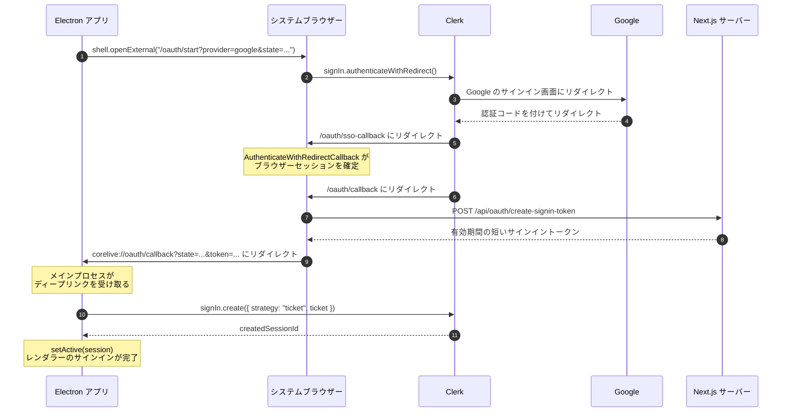

import { ArticleLayout } from '@/components/ArticleLayout'

export const article = {
  author: 'Ryota Murakami',
  title:
    'Next.js 16 App Router と Clerk v7 で Electron に Google OAuth を実装する',
  date: '2026-04-08',
  description:
    'Next.js 16 App Router と Clerk v7 を使い、システムブラウザー、ディープリンク、有効期間の短いサインイントークンで Electron アプリに Google OAuth を実装する手順です。',
}

export default (props) => <ArticleLayout article={article} {...props} />

Electron で Google OAuth を使うのは簡単そうに見えます。いざ本番に出そうとすると、そうはいきません。

一般的な Web アプリなら、Clerk はブラウザー内で認証を完了し、Cookie でセッションを維持できます。Electron アプリでは、その前提がすぐに崩れます。

- Google は埋め込みブラウザーからのサインインを `403: disallowed_useragent` で拒否する
- システムブラウザーのセッションと Electron のレンダラーのセッションでは Cookie の保存領域が異なる
- 多くの実装例は `authenticateWithRedirect()` を呼ぶところまでで、デスクトップアプリへの引き継ぎに触れていない

試行錯誤の末、**Next.js 16 App Router**、**Electron**、**Clerk v7** を組み合わせて、本番でも安定して動くフローにたどり着きました。

この記事では、その実装と、実際につまずいた箇所を紹介します。

---

## 動作を確認できた認証フロー

私の環境では、**システムブラウザーで認証し、ディープリンクで Electron に戻る**構成が機能しました。



流れをまとめると、次のようになります。

- **システムブラウザーで OAuth 認証を行う**
- **サーバーで有効期間の短いサインイントークンを発行する**
- **ディープリンクで Electron に戻る**
- **トークンを使ってレンダラーに新しいセッションを作る**

ブラウザーのセッションで発行したトークンを渡し、Electron 側で独立したセッションを作る仕組みです。

---

## Electron の中で直接 Google OAuth を実行できない理由

Electron の `BrowserWindow` や `webview` 内で Google のサインイン画面を開くと、いずれ次のエラーに行き当たります。

```text
403: disallowed_useragent
```

これは Google が埋め込みブラウザーでの認証を拒否しているためです。

それぞれの役割を整理すると、こうなります。

- Electron アプリが認証を開始する
- 通常のブラウザーが機密性の高い OAuth の手順を担当する
- ブラウザーが `corelive://` などのカスタムプロトコル経由でアプリに戻る

このパターンに名前を付けるなら、**ディープリンクのコールバックを使うシステムブラウザー OAuth** がわかりやすいと思います。

---

## Next.js App Router のルート構成

私の場合は、最終的に 4 つの専用ルートに分けました。

| ルート                           | 役割                                                              |
| -------------------------------- | ----------------------------------------------------------------- |
| `/oauth/start`                   | システムブラウザーで Clerk OAuth を開始する                       |
| `/oauth/sso-callback`            | Clerk の `<AuthenticateWithRedirectCallback />` を配置する        |
| `/oauth/callback`                | 使い切りのサインイントークンを作成し、Electron にリダイレクトする |
| `/api/oauth/create-signin-token` | 有効期間の短い Clerk サインイントークンを発行するサーバールート   |

役割を分けたことで、フローをデバッグしやすくなりました。

---

## 1. Electron からシステムブラウザーで OAuth を開始する

Electron 側では `state` を生成して OAuth の開始 URL を組み立て、`shell.openExternal()` で開きます。

```ts
const state = crypto.randomBytes(32).toString('hex')

const oauthUrl = `${getWebAppOrigin()}/oauth/start?provider=google&state=${state}`

await shell.openExternal(oauthUrl)
```

重要なのは、**現在の BrowserWindow の URL から Web アプリのオリジンを求める**ことです。

開発環境では `http://localhost:3011` を開き、本番環境では `https://corelive.app` を開く、といった違いがあるからです。

Electron が異なるオリジンを開くと、一方の Clerk インスタンスで OAuth の状態を作り、もう一方でその結果を使おうとしてしまいます。

そうなると、原因のわかりにくいエラーが出ます。

- チケットが無効になる
- セッションが見つからない
- ディープリンクでは戻ってこられるものの、Electron でサインインできない

私の実装では、ここが特に重要な修正点の一つでした。

---

## 2. `/oauth/start` で Clerk OAuth を開始する

ブラウザーで最初に開くページは、`signIn.authenticateWithRedirect()` を呼び出すクライアントコンポーネントです。

```tsx
await signIn.authenticateWithRedirect({
  strategy: 'oauth_google',
  redirectUrl: `/oauth/sso-callback?state=${encodeURIComponent(state)}`,
  redirectUrlComplete: `/oauth/callback?state=${encodeURIComponent(state)}`,
})
```

2 つの URL は次のように使い分けます。

- `redirectUrl` は認証フローの途中で使う URL
- `redirectUrl` には、Clerk のリダイレクトコールバックを実行するルートを指定する
- `redirectUrlComplete` は、*Clerk がブラウザーセッションを確定したあと*に進む URL

ここを分けず、Google から直接アプリ独自の引き継ぎページへ戻そうとすると、フローが不安定になります。

私のアプリでは、ブラウザーに有効な Clerk セッションがすでにある場合も `/oauth/start` で処理します。

```tsx
if (isUserLoaded && user) {
  window.location.replace(`/oauth/callback?state=${encodeURIComponent(state)}`)
  return
}
```

こうしておかないと、Clerk が次のエラーを返す場合があります。

```text
You're already signed in.
```

この場合は OAuth の再開を省き、そのまま引き継ぎページに進むのが通常は適切です。

---

## 3. `/oauth/sso-callback` で Clerk にブラウザーセッションを確定させる

コールバックルートの実装は最小限にします。

App Router では、Clerk のコールバックコンポーネントを置くだけです。

```tsx
<AuthenticateWithRedirectCallback
  signInForceRedirectUrl={`/oauth/callback?state=${encodeURIComponent(state ?? '')}`}
  signUpForceRedirectUrl={`/oauth/callback?state=${encodeURIComponent(state ?? '')}`}
/>
```

このルートは、Clerk がブラウザー側のサインインを正しく完了するためだけに使います。

ここも間違えやすい箇所でした。`/oauth/sso-callback` を Clerk の処理に任せ、アプリ独自の処理を `/oauth/callback` に置くと、うまく動きました。

---

## 4. サーバーで有効期間の短いサインイントークンを発行する

Clerk のブラウザーセッションが認証済みになったら、Electron が使う有効期間の短いトークンを発行します。

私のサーバールートは次のようになっています。

```ts
import { auth, clerkClient } from '@clerk/nextjs/server'
import { NextResponse } from 'next/server'

export async function POST() {
  const { userId } = await auth()

  if (!userId) {
    return NextResponse.json(
      { error: 'Not authenticated. Please sign in first.' },
      { status: 401 },
    )
  }

  const client = await clerkClient()
  const signInToken = await client.signInTokens.createSignInToken({
    userId,
    expiresInSeconds: 60,
  })

  return NextResponse.json({
    token: signInToken.token,
  })
}
```

ここでトークンを使う理由は、次のとおりです。

- ブラウザーのセッションを Electron 内で直接再利用できない
- トークンの**有効期間が短い**
- トークンを使えるのは **1 回だけ**
- すでに認証済みのブラウザーセッションでのみ発行できるよう、サーバー側で制御できる

Clerk のサインイントークン API の既定の有効期間はもっと長く設定されています。ブラウザーからデスクトップへ引き継ぐ用途なら、**60 秒**など、ずっと短い期間を強く勧めます。

---

## 5. ディープリンクで Electron に戻る

`/oauth/callback` では、トークンの発行後にブラウザーからデスクトップアプリへリダイレクトします。

```ts
const deepLink = `corelive://oauth/callback?state=${encodeURIComponent(state)}&token=${encodeURIComponent(token)}`

window.location.href = deepLink
```

これでブラウザー側の処理は完了です。

Electron はメインプロセスでディープリンクを受け取り、`state` を検証して、レンダラーがトークンを使えるようにします。

---

## 6. Electron のレンダラー内でトークンを交換する

Electron のレンダラー内では、Clerk の準備ができるのを待ってから、返ってきたトークンを Clerk のチケット方式で交換します。

```ts
const signInAttempt = await client.signIn.create({
  strategy: 'ticket',
  ticket: token,
})

if (signInAttempt.status === 'complete' && signInAttempt.createdSessionId) {
  await setActive({
    session: signInAttempt.createdSessionId,
    navigate: ({ decorateUrl }) => {
      window.location.href = decorateUrl('/home')
    },
  })
}
```

ここで重要なのは、Electron がチケットから**自分専用の** Clerk セッションを作り、`setActive()` でそのセッションをローカルに有効化することです。

これで、レンダラー内で認証が必要なクエリを実行できるようになります。

---

## 実際につまずいたポイント

特に時間を取られた問題を挙げます。

### 1. `redirectUrl` と `redirectUrlComplete` は用途が異なる

おそらく、ここがいちばん間違えやすいところです。

次の指定で機能しました。

- `redirectUrl` → Clerk のコールバックページ
- `redirectUrlComplete` → アプリ独自の引き継ぎページ

両方に同じルートを指定したり、`redirectUrl` をディープリンクの引き継ぎページに向けたりすると、ブラウザーセッションが未確定のままになったり、後続処理の `state` が無効になったりしがちです。

### 2. ブラウザーがすでにサインイン済みの場合がある

特に開発中は、以前のテストで使った Clerk セッションがシステムブラウザーに残っていることがよくあります。

毎回そのまま `authenticateWithRedirect()` を呼ぶと、Clerk が次のエラーを返すことがあります。

```text
You're already signed in.
```

対処はシンプルです。

- ブラウザーですでにサインイン済みのユーザーを検出する
- または、この Clerk エラーだけを捕捉する
- そのまま `/oauth/callback` に進む

### 3. Clerk の環境を混在させない

ここにはかなり苦戦しました。

Electron アプリでは開発用の Web アプリを読み込んでいたのに、システムブラウザーには本番 URL を開かせていました。その結果、次の状態になっていました。

- ある Clerk インスタンスで OAuth を開始
- 戻ってきたトークンやチケットを別のインスタンスで使用

認証が不規則に失敗しているように見えましたが、実際には環境の不一致が原因でした。

本番ドメインをハードコードしていた箇所を修正し、現在の Electron ウィンドウの URL から OAuth の開始オリジンを求めるようにしました。

### 4. サインイントークンを引き継ぎに使えるのは 1 回だけ

トークンの交換に失敗した場合、同じトークンでの再試行は避けます。

そのトークンを破棄して、最初からやり直します。

さもないと、次の状態を繰り返しかねません。

- 保留中のまま古くなったトークン
- 無効なチケット
- 成功することのないコールバック処理の繰り返し

### 5. レンダラーで Clerk の準備ができるまで待つ

レンダラーが Clerk を読み込み終える前に、ディープリンクが届くことがあります。

早すぎる段階でトークンを処理すると、ランダムに見える競合が起きます。

最終的に、次のように実装しました。

- Clerk の準備がまだなら、一時的なリスナーでトークンを受け取って保存する
- `client.signIn` が利用できるようになった段階で、保存したトークンを使う

この小さなバッファーを挟むだけで、フローがずっと安定しました。

### 6. React の開発モードでは処理が 2 回始まることがある

開発モードでは、`/oauth/start` ページでエフェクトが 2 回実行されることがあります。

対策せずにエフェクトを動かすと、リダイレクト処理を複数回始めてしまうことがあります。

私は ref で 1 回だけ実行するようにしました。

```tsx
const hasStartedOAuth = useRef(false)

if (hasStartedOAuth.current) {
  return
}

hasStartedOAuth.current = true
```

### 7. ログイン直後に認証が必要なクエリを急いで実行しない

Electron でチケットの交換が終わったあとも、最初にデータを取得すると `401 Unauthorized` が出ました。

原因は、レンダラーの Clerk セッションが完全に確定する前に、認証が必要なクエリを実行していたことでした。

Clerk のユーザーとセッション情報が利用できるようになるまで、認証が必要なクエリを始めないように修正しました。

一見 OAuth と関係なさそうですが、これも実際には認証結果の引き継ぎで起きる問題です。

---

## 最終的な App Router のファイル構成

参考までに、私の環境でうまくいった構成を載せます。

```text
src/app/oauth/start/page.tsx
src/app/oauth/sso-callback/page.tsx
src/app/oauth/callback/page.tsx
src/app/api/oauth/create-signin-token/route.ts
electron/OAuthManager.ts
src/lib/orpc/electron-auth-provider.tsx
```

次に作るとしても、この役割分担にします。

1 つか 2 つのルートにまとめてみたところ、かえって処理を追いにくくなりました。

---

## おすすめの実装手順

**Electron + Clerk + Google OAuth** をこれから組むなら、私は次の手順を勧めます。

1. Electron から OAuth を始め、**システムブラウザー**を開く
2. ブラウザーで開く専用ルートで Clerk の `authenticateWithRedirect()` を使う
3. `<AuthenticateWithRedirectCallback />` を置いた、Clerk 専用のコールバックページを作る
4. 認証済みのブラウザーセッションで**有効期間の短いサインイントークン**を発行する
5. カスタムディープリンクで Electron に戻る
6. レンダラーで Clerk の**チケット方式**を使い、トークンをセッションに交換する
7. `setActive()` でレンダラーの新しいセッションを有効化する

Web だけで完結する通常の OAuth よりも手順は増えますが、Electron の中で無理に Google サインインを行うよりはるかに安定します。

---

## 実装を振り返って

意外だったのは、Electron の OAuth の難しさのうち、Google や Clerk 個別の設定は一部分でしかなかったことです。

本当に難しかったのは、次の 3 つの間で認証結果を引き継ぐことでした。

- ブラウザーのセッション
- デスクトップアプリへのディープリンク
- Electron 内のもう一つのセッション

これらを**独立した 3 つの段階**として扱うと、実装をずっと理解しやすくなりました。

この構成に実用的な名前を付けるなら、次のようになります。

> **システムブラウザーでの OAuth、ディープリンクによる引き継ぎ、チケットによるレンダラーセッションの有効化**

短い名前にはなりませんが、実際に動いたのはこの構成でした。

---

## 参考資料

- [Clerk のドキュメント（カスタム OAuth フロー）](https://clerk.com/docs/guides/development/custom-flows/authentication/oauth-connections)
- [Clerk のドキュメント（AuthenticateWithRedirectCallback）](https://clerk.com/docs/reference/components/control/authenticate-with-redirect-callback)
- [Clerk のドキュメント（サインイントークンの発行）](https://clerk.com/docs/reference/backend/sign-in-tokens/create-sign-in-token)
